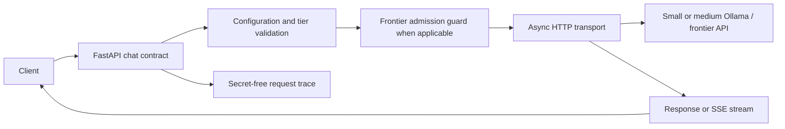
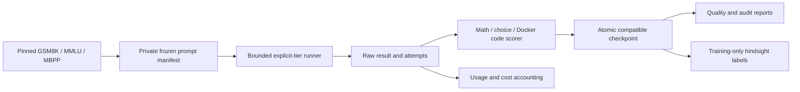

# Implemented architecture

This guide describes the code present now. Planned routing, verification, caching, and deployment components are tracked separately in [feature status](FEATURE_STATUS.md).

## Gateway request path

`src/jev_gateway/api.py` accepts text-only OpenAI-style chat with an explicit `model` tier. `model=auto`, image/audio, tools, and routing are not implemented. `config.py` reads backend URLs, model tags, timeouts, and frontier caps from the environment. `transport.py` owns the bounded `httpx` client and forwards a nonstreaming completion or streaming bytes. `budget.py` reserves a conservative process-local frontier allowance before dispatch. `tracing.py` records request ID, tier, configured model, start time, duration, usage fields when returned, and cost status without storing prompt text. `diagnostics.py` powers `doctor` and `smoke`; `/healthz` checks the process and `/readyz` does not certify a loaded model.

A backend completion body is returned intact for nonstreaming calls. Headers carry request ID and tier metadata. Streaming forwards SSE without assembling a full response. Once streaming headers have been sent, a midstream error cannot be turned into a normal JSON error; the trace records interruption. A local `httpx` mock proves forwarding logic, while a real backend response requires a reachable model service.

## Evaluation data path

`evaluation/datasets.py` formats source rows and retains source IDs, revision, answer provenance, and private MBPP tests. `manifest.py` selects 2,500 prompts with a fixed seed, groups normalized duplicates, and assigns project train/validation/test splits. Only an ID/hash index is tracked; raw source rows and the full manifest are ignored under `data/day2_sources/` and `runs/`. The project test split is gated from normal evaluation commands.

`records.py` defines immutable prompt, result, and attempt records. Outcomes distinguish correct, incorrect, parse error, backend error, evaluator error, and blocked scoring. `runner.py` applies request, token, concurrency, retry, deadline, and paid-call limits. It records real transport outcomes and does not substitute mocks when a backend is down. `checkpoint.py` atomically stores completed compatible prompt/tier results; the original run ID and timing remain available on reuse. Reports read an explicit run file so failed attempts are not hidden by successful checkpoints.

`scoring.py` handles explicit numerical and conservative A–D extraction. Coding completions go to `sandbox.py`, which invokes a bounded Docker container with no network or writable project mount. It never falls back to executing generated code on the host. `audit.py` exports private development rows marked pending review. `oracle.py` labels only complete training observations with comparable costs. `cost.py` separates known charges, rate-based API estimates, unknown costs, and modeled allocated capacity. `report.py` states coverage and denominators. `serving.py` and `latency.py` keep controlled client traffic measurements separate from answer-quality collection.

## Trust and measurement boundaries

- Source benchmark answers and MBPP tests are private evaluation inputs. They are not placed in model prompts except for the task text and MMLU choices.
- Docker reduces the risk of running generated code; it is not an absolute security boundary. The pinned image must be present and Docker Engine running.
- Application-side budget counters are local to a process and are not provider billing limits. A concurrent provider may bill attempts whose usage cannot be recovered after a transport failure.
- `first_visible_s` measures the first nonempty streamed text at the client. It is not GPU execution time. Provider token counts are used only when actually returned.
- No quality, cost, or latency claim about live models can be drawn from the current two failed local attempts.
