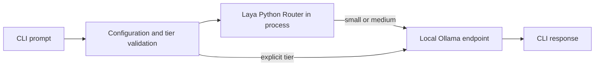
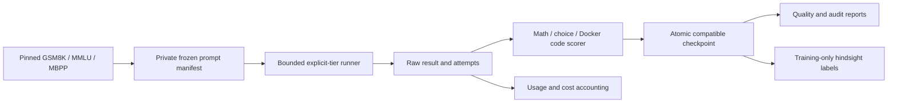

# Implemented architecture

This describes the current CLI and the separate research/evaluation code. The historical HTTP gateway is no longer the supported interactive application.

## Native CLI chat path

`src/laya_gateway/cli.py` exposes `doctor`, `smoke`, `chat`, and bounded evaluation commands. `chat --model auto` loads only the pinned typed-decision checkpoint using Laya's Python API in-process, makes a local tier decision, then calls the selected Ollama model. There is no gateway HTTP listener and no separate Laya process. Explicit `small` or `medium` choices bypass Laya decisions. `config.py` reads local backend endpoints, model tags, caps, and device settings from the environment; `diagnostics.py` checks the installed checkpoint and local Ollama tags. The generation transport uses Ollama's loopback OpenAI-compatible endpoint. This is local backend transport and is not an externally exposed gateway API.

Laya is an optional package extra pinned in `requirements/laya.txt`. The core package remains installable without Laya, but automatic chat and `doctor` require the Laya extra and pinned checkpoint. A direct checkpoint inference was observed during this migration; routing quality on this project's prompts has not been evaluated. The first invocation may download model files.

## Evaluation data path

`evaluation/datasets.py` formats source rows and retains source IDs, revision, answer provenance, and private MBPP tests. `manifest.py` selects 2,500 prompts with a fixed seed, groups normalized duplicates, and assigns project train/validation/test splits. Only an ID/hash index is tracked; raw source rows and the full manifest are ignored under `data/day2_sources/` and `runs/`. The project test split is gated from normal evaluation commands.

`records.py` defines immutable prompt, result, and attempt records. Outcomes distinguish correct, incorrect, parse error, backend error, evaluator error, and blocked scoring. `runner.py` applies request, token, concurrency, retry, deadline, and paid-call limits. It records real transport outcomes and does not substitute mocks when a backend is down. `checkpoint.py` atomically stores completed compatible prompt/tier results; the original run ID and timing remain available on reuse. Reports read an explicit run file so failed attempts are not hidden by successful checkpoints.

`scoring.py` handles explicit numerical and conservative A–D extraction. Coding completions go to `sandbox.py`, which invokes a bounded Docker container with no network or writable project mount. It never falls back to executing generated code on the host. `audit.py` exports private development rows marked pending review. `oracle.py` labels only complete training observations with comparable costs. `cost.py` separates known charges, rate-based API estimates, unknown costs, and modeled allocated capacity. `report.py` states coverage and denominators. `serving.py` and `latency.py` keep controlled client traffic measurements separate from answer-quality collection.

## Trust and measurement boundaries

- Source benchmark answers and MBPP tests are private evaluation inputs. They are not placed in model prompts except for the task text and MMLU choices.
- Docker reduces the risk of running generated code; it is not an absolute security boundary. The pinned image must be present and Docker Engine running.
- Application-side budget counters are local to a process and are not provider billing limits. A concurrent provider may bill attempts whose usage cannot be recovered after a transport failure.
- `first_visible_s` measures the first nonempty streamed text at the client. It is not GPU execution time. Provider token counts are used only when actually returned.
- No quality, cost, or latency claim about live models can be drawn from the current two failed local attempts.
