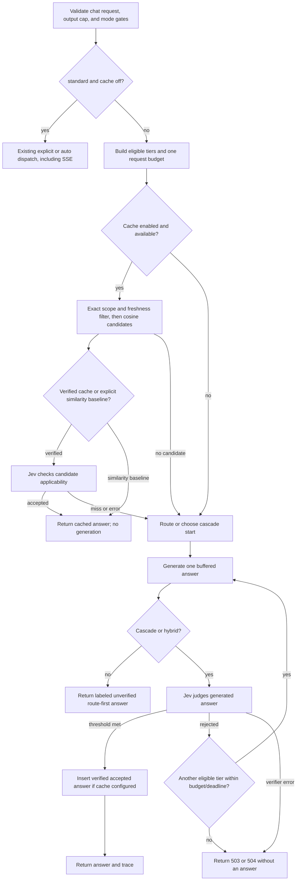

# Day 4 engineering handoff — 2026-10-30 America/Toronto

Day 4 adds an optional buffered execution path to the existing text-only gateway. The legacy `execution_mode=standard`, `cache_mode=off` path retains explicit tiers, `model=auto`, and SSE. The new route-first, cascade, and hybrid paths are offline-tested with controlled HTTP/verifier fixtures. No real generation, Jev judgment, MiniLM embedding, or native FAISS search ran on this Mac.

## Request path



A cache candidate passes exact instruction, conversation, namespace, policy, model, generation-setting, embedding-revision, expiry, and current backend eligibility gates before applicability. Cosine similarity is only retrieval. For verified reuse, Jev asks a separate typed question about whether the stored answer applies to the new request. Verification of a newly generated answer asks whether that answer satisfies the request. These probabilities represent different events and require separately documented thresholds. The cache is a local single-writer index, not a cross-replica shared service.

## HTTP modes and behavior

| Request fields | Behavior | Return label |
| --- | --- | --- |
| `standard` + `off` (defaults) | Existing explicit tier or auto dispatch; SSE supported | Existing headers |
| `route_first` + `off` | `model=auto`; route once and generate one buffered answer | `unverified_route_first` |
| `cascade` + `off` | `model=auto` or `small`; small→medium→frontier, verify each successful generation | `accepted_verified` or no answer |
| `hybrid` + `off` | `model=auto`; route to starting tier, then verify/escalate | `accepted_verified` or no answer |
| Any new mode + `verified` cache | Check scoped candidates with Jev first; insert only accepted verified generation | `verified_hit`, `inserted`, or miss/failure |
| Any new mode + `similarity_only` cache | Explicit experimental flag; reuse candidate without applicability judgment | `similarity_only_hit`, `experimental_unverified` |

New modes reject `stream=true` with 422 because rejected provisional tokens must never be sent as final output. `route_first` and `hybrid` require `model=auto`; `cascade` starts at small. A failed or missing verifier returns no answer under the HTTP path's fail-closed policy. A cache read/check failure becomes a generation miss; an insertion failure does not discard an already accepted answer. Missing router, exhausted request caps, or no accepted answer returns 503; a whole-request deadline returns 504. Full stage reservations and attempt outcomes are logged in secret-free traces. Responses include `x-jev-cache`, `x-jev-verification`, `x-jev-tier`, `x-jev-backend-model`, and `x-request-id`; cache-hit usage is unknown rather than imputed from the original answer.

## Configuration and safe commands

The core installs without embedding, training, or CUDA packages. The optional `embeddings` extra supplies Sentence Transformers and FAISS; `MiniLMEncoder` requires a pinned immutable local revision of `sentence-transformers/all-MiniLM-L6-v2` and defaults to local-files-only loading. Set `JEV_CACHE_PATH` to a local writable directory, `JEV_CACHE_EMBEDDING_REVISION`, `JEV_CACHE_SIMILARITY_THRESHOLD`, `JEV_CACHE_SIMILARITY_THRESHOLD_SOURCE`, and `JEV_CACHE_NAMESPACE` to enable retrieval. Set `JEV_CACHE_VERIFICATION_THRESHOLD` and its `_SOURCE` for verified reuse. No validated operating threshold has been selected, so the gateway has no ready real cache configuration.

Verified execution additionally needs `JEV_VERIFICATION_THRESHOLD` and `_SOURCE`, `JEV_EXECUTION_PAID_ENABLED=true`, positive `JEV_EXECUTION_MAX_REQUESTS`, `_MAX_TOKENS`, and `_MAX_USD`, plus the existing TypeSafe key/model/sourced rates and positive Jev process caps. Frontier escalation still needs its own key/model/rates/caps. Do not copy test fixture thresholds or prices into a live run. `JEV_CACHE_SIMILARITY_ONLY_ENABLED=true` alone enables the experimental similarity-only mode. Cache TTL defaults to 86,400 seconds. The request budget is cumulative per HTTP request; Jev/frontier process budgets are extra ceilings, not a durable multi-process billing ledger. Local compute cost and some provider usage remain unknown.

```sh
.venv/bin/pytest -q
.venv/bin/jev doctor
.venv/bin/jev serve
```

An HTTP request to the running gateway can set `"model":"auto", "execution_mode":"hybrid", "cache_mode":"verified"` in `/v1/chat/completions` JSON after the corresponding configuration is actually supplied. Until then, the verified path returns 503 before paid calls. Existing explicit-tier requests need no new fields.

## Checkpoint mapping and validation

| Checkpoint | Commit | Result |
| --- | --- | --- |
| D4-01 | `199343f` | Typed generated-answer Jev judgment |
| D4-02 | `4c995f2` | Explicit acceptance and failure policy |
| D4-03 | `ae6a773` | Finite buffered cascade |
| D4-04 | `9f1ea4a` | Route-first, cascade, hybrid composition |
| D4-05 | `7aa6eec` | Cumulative request budget |
| D4-06 | `4926633` | Independent scored-answer mode comparison reader |
| D4-07 | `c42c7f4` | Verifier error metrics with denominators |
| D4-08 | `fa6bec3` | Optional pinned MiniLM adapter |
| D4-09 | `16f4e35` | Versioned FAISS storage |
| D4-10 | `4899ce2` | Exact semantic cache scope |
| D4-11 | `fd781ee` | Scoped cosine candidates |
| D4-12 | `9dbfaee` | Jev cache applicability judgment |
| D4-13 | `aeb88e8` | Cache insertion, expiry, eviction, reset |
| D4-14 | `971eef0` | Grouped paraphrase/near-miss validation cases |
| D4-15 | `c6e3593` | Cache quality/coverage report |
| D4-16 | `adfc89c` | Scope, corruption, verifier failure regression checks |
| D4-17 | `66c19e6` | HTTP execution and cache integration |
| D4-18 | This handoff commit | Evidence and operating contract |

The final Mac offline check `.venv/bin/pytest -q` returned **99 passed, one third-party Starlette deprecation warning, 0.46 seconds**. Raw output: `evidence/day4/mac-offline-20261030-1838.txt`. `jev doctor` reported both configured Ollama tiers unavailable with `ConnectError` and frontier unconfigured; raw JSON: `evidence/day4/mac-doctor-20261030-1838.json`. The 12 grouped hand-authored cache cases are validation examples, not held-out test data. The cache comparison preflight had zero real observations and therefore no cache quality or threshold result. All HTTP integration tests use mock transport and controlled verifier/checker fixtures. Jev, MiniLM, native FAISS, frontier, DistilBERT, Colab, and end-to-end latency remain untested in real execution.

## Day 5 prerequisites

Start and profile native Ollama tiers, obtain complete real Day 2 train/validation observations, train and export the DistilBERT fallback in Colab, select verifier and cache thresholds from scored validation data, install and validate pinned embedding/FAISS artifacts on Mac, and configure sourced Jev/frontier rates plus explicit positive run caps before paid calls. Preserve raw runs and keep the held-out test untouched until the planned final evaluation.
