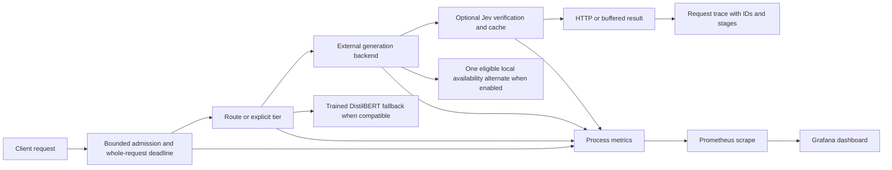

# Day 5 engineering handoff — 2026-10-31 America/Toronto

Day 5 packages the existing gateway, exposes bounded process metrics, controls Jev outages and request admission, and provides local monitoring, load, and kind workflows. Generation stays on native Ollama or configured APIs. The image has no model weights or credentials. The default local profiles keep paid execution off. `/healthz` checks process liveness; `/readyz` checks process readiness and explicitly reports backend availability as unchecked. A configured DistilBERT router or explicitly required trained fallback prevents readiness when its artifact cannot load. Use `jev doctor` and a bounded answer request to assess actual model service.

## Request and observation path



One client request increments `jev_client_requests_total` once, while each generation attempt increments its own counter. Histograms keep bounded buckets and labels contain only fixed modes, tiers, outcomes, stages, and HTTP status. Streaming first-output timing exists only when bytes arrive. USD metrics are estimated reservations; unknown usage and cost are recorded as unknown, never imputed as zero. Prometheus computes service p95 from summed buckets across instances. Dashboard rates use five-minute windows, so a new or empty series can show no data. Request IDs, exact failure categories, and stage reservations remain in JSON traces, not metric labels.

The Jev breaker opens after three qualifying dependency failures by default, waits 30 seconds, and allows one half-open probe. Network failures, malformed replies, and HTTP 5xx qualify; local budget denials and HTTP 4xx do not. A compatible trained DistilBERT artifact may route while Jev is unavailable. Its tier classifier is never an answer verifier, so a verification outage remains fail closed. HTTP admission defaults to eight active requests and 16 queued requests per process. Queue waiting consumes the same deadline. Gateway transports have zero automatic retries. `JEV_AVAILABILITY_FAILOVER_ENABLED=true` allows one eligible local alternate for buffered standard `model=auto` after an availability failure; explicit tiers, streaming, HTTP 4xx, and implicit frontier upgrades are excluded. Day 4 answer-quality escalation remains a separate policy.

## Compose on Mac

Docker Desktop, native Ollama, and the configured local models are separate prerequisites. The current Mac could build and start the image, but `host.docker.internal:11434` was unreachable from the container. Start and check Ollama first, then verify reachability *from the container*; successful DNS resolution alone is insufficient. Do not expose a model port to a public interface to work around the failure. The core image installs only locked gateway dependencies. DistilBERT and embedding artifacts are not hidden in it; mount the same immutable trained artifact into every replica if that feature is later enabled.

```sh
docker compose config --quiet
docker compose up -d --build
curl -fsS http://127.0.0.1:8080/healthz
curl -fsS http://127.0.0.1:8080/readyz
curl -fsS http://127.0.0.1:8080/metrics
docker compose exec -T gateway /app/.venv/bin/jev doctor
# Grafana: http://127.0.0.1:3000 ; Prometheus: http://127.0.0.1:9090
docker compose down
```

The `doctor` command exits nonzero if a backend is unavailable, as it did here. Compose binds the gateway and monitoring UIs to loopback only. It reads an optional untracked `.env`; keep secrets there or in a separate secret store, never in images or Git. `docker compose down` retains Prometheus and Grafana volumes. `docker compose down -v` resets those *project* monitoring volumes and deletes their saved data. The Prometheus scrape target is `gateway:8080`; native Ollama metrics are not asserted to exist. The dashboard was provisioned with 14 panels and 17 queries; all expressions parsed against the running Prometheus API. A bounded failed-backend request emitted the expected HTTP 502 and generation-error series.

## kind and replica boundaries

The verified cluster was named `jev-gateway-day5`, used kind v0.33.0, and loaded the pinned `kindest/node:v1.37.0@sha256:a1ed56cfb0e7b93589bdf97c8cd566405a265939e3620fc4f5de89adff580ae5` ARM image. It is no longer running; the node image was removed after the test to recover disk. The following commands recreate only that project cluster and namespace after installing the official kind CLI:

```sh
docker build --platform linux/arm64 -t jev-gateway:day5 .
kind create cluster --name jev-gateway-day5 --config deploy/kind/cluster.yaml --image kindest/node:v1.37.0@sha256:a1ed56cfb0e7b93589bdf97c8cd566405a265939e3620fc4f5de89adff580ae5 --kubeconfig /private/tmp/jev-kind-kubeconfig --wait 120s
kind load docker-image jev-gateway:day5 --name jev-gateway-day5
kubectl --kubeconfig /private/tmp/jev-kind-kubeconfig apply -f deploy/kind/gateway.yaml
kubectl --kubeconfig /private/tmp/jev-kind-kubeconfig -n jev-gateway rollout status deployment/jev-gateway --timeout=90s
kubectl --kubeconfig /private/tmp/jev-kind-kubeconfig -n jev-gateway port-forward --address 127.0.0.1 service/jev-gateway 18081:8080
# In another terminal: curl -fsS http://127.0.0.1:18081/readyz
kind delete cluster --name jev-gateway-day5 --kubeconfig /private/tmp/jev-kind-kubeconfig
```

The manifest defaults to two pods, a ClusterIP Service, cache off, and paid execution off. Startup/liveness probes call `/healthz`; readiness calls `/readyz`. The Service is internal and the port-forward is loopback. Pod DNS resolved `host.docker.internal` to `192.168.65.254`, but the actual request to Ollama failed with `Network is unreachable`; in-pod doctor reported `ConnectError` for both tiers. Each replica has independent metrics, breaker state, budget counters, and optional cache state. Never point both pods at one writable FAISS directory. Process-local provider caps are not a global multi-replica spending cap. A trained artifact needs a read-only mount and matching fingerprint on each pod; `JEV_REQUIRE_TRAINED_FALLBACK=true` makes its absence block readiness. Scaling gateway pods does not increase Ollama capacity.

The actual pod-replacement experiment is reproducible with `python3 scripts/kind_replacement.py --kubeconfig /private/tmp/jev-kind-kubeconfig --output runs/day5-pod-replacement-new.json --requests 40 --interval 0.1 --execute` after two pods are ready. It deletes only one named project pod. Run `--execute` only in the dedicated test cluster. The saved run `day5-pod-20261031T194116Z` sent 40 in-cluster `GET /v1/models` requests over 4.812771874945611 seconds: 39 returned HTTP 200, one returned `URLError` at index 5, and sampled readiness fell to one pod before returning to two. This was API traffic without generation. Raw responses and pod timeline are in `evidence/day5/kind-pod-replacement-20261031.json`.

## Load and controlled failures

Locust 2.47.0 was installed in a temporary Python venv for the wiring check. For a new Mac session, create a separate venv and install that version; the core gateway installation does not need Locust. The runner requires a new output directory, positive request/token limits, workload placement, and model condition. Without `--execute` it prints a pending manifest and sends no traffic. These are closed-loop user schedules, not fixed arrival rates. The spike changes users from baseline to five times baseline for two minutes, then observes two minutes of recovery; the reporter compares achieved `Requests/s` from history, not the user multiplier. Real paid-capable runs require explicitly enabled positive gateway provider caps and a declared run USD ceiling covering their sum. The runner cannot coordinate spending across gateway replicas.

```sh
python3 -m venv /private/tmp/jev-locust-venv
/private/tmp/jev-locust-venv/bin/python -m pip install 'locust==2.47.0'
PATH=/private/tmp/jev-locust-venv/bin:$PATH python3 load/run.py --scenario steady --base-users 1 --max-requests 800 --max-tokens 25600 --output-tokens 32 --placement mac-host --model-condition unverified --output runs/day5-steady-new
# Add --execute only after doctor and a bounded real answer succeed.
PATH=/private/tmp/jev-locust-venv/bin:$PATH python3 load/run.py --scenario steady --base-users 1 --max-requests 800 --max-tokens 25600 --output-tokens 32 --placement mac-host --model-condition unverified --output runs/day5-steady-new --execute
python3 load/report.py --run runs/day5-steady-new
```

Use `--scenario spike` with a new output path, up to six minutes, and a request cap sized for baseline, spike, and recovery. Use `--scenario soak` with a new path, 3,600 seconds, and enough disk/resource headroom. The run saves a manifest, per-request JSONL, Locust CSV/logs, and periodic Docker resource observations. The reporter states actual duration, failures, throughput, latency, spike achieved-rate ratio, and soak memory samples only when present. Do not call a shorter interrupted run a completed ten-minute steady or one-hour soak. The only Locust execution here was run `day5-20261031T194858Z`: two small-tier requests in 1.884353 seconds, both HTTP 502, zero model answers. Its periodic CSV was stale at zero; raw events correctly recorded both failures. See the committed `evidence/day5/locust-smoke-*20261031T194858Z.*` files. The ten-minute steady, fivefold achieved-rate spike, and one-hour soak remain pending.

The safe Jev outage check is `.venv/bin/pytest -q tests/routing/test_outage_integration.py`. It injects HTTP 503 responses only through `httpx.MockTransport`, uses a clearly labeled classifier fixture, checks breaker open/half-open/closed metrics, and verifies that an answer-verifier outage returns 503. The fixture restores itself when the test exits; it makes no live Jev call and changes no external service. A live outage-under-load experiment requires a real trained fallback, configured Jev and generation, an explicit paid/run budget, and a scoped reversible fault method. None was run.

## Checkpoint commits and Day 6 prerequisites

| Checkpoint | Commit | Evidence state |
| --- | --- | --- |
| D5-01 | `ba4f456` | ARM build/start passed; locked-install fix `4f9bb54` |
| D5-02 | `559d4df` | Compose configuration and gateway startup passed; Ollama unavailable |
| D5-03 | `86198bb` | Offline metrics test and actual emitted series |
| D5-04 | `e4bf71d` | Offline breaker/fallback tests; no trained artifact |
| D5-05 | `1478d27` | Offline admission/cancellation tests |
| D5-06 | `5ac8ded` | Offline local failover tests |
| D5-07 | `e089049` | Promtool and actual up scrape |
| D5-08 | `9807b07` | Grafana provisioned; 17 queries parsed |
| D5-09 | `40485b6` | Scenario dry-run; paid-cap fix `01067f6` |
| D5-10 | `933fd8e` | Real ten-minute inference run pending; raw-event fix `8672e0f` |
| D5-11 | `0f9b427` | Real achieved-rate spike pending |
| D5-12 | `1e6c7b3` | Real one-hour soak pending |
| D5-13 | `ac7664b` | Named kind rollout and in-pod probes passed |
| D5-14 | `301003e` | Two pods ready; external Ollama unavailable |
| D5-15 | `18068d3` | 40-request API pod replacement observed |
| D5-16 | `ab04345` | Controlled Jev outage fixture only |
| D5-17 | `74443c5` | Local 50-case matrix passed; remote CI pending |
| D5-18 | This handoff commit | Docs and final engineering evidence |

The final local suite passed 119 tests, one third-party warning, in 0.92 seconds. Raw output is `evidence/day5/mac-offline-20261031.txt`. Mac native Ollama, actual model residency, trained DistilBERT artifact, Jev/frontier credentials and sourced rates, real verifier/cache thresholds, live model load, and Colab GPU remain unavailable. Day 6 must preserve Mac and Colab profiles separately, finish the NVIDIA optimization investigation, and freeze settings before the still-unused held-out test. No final quality/cost/performance result should be inferred from these deployment checks.
