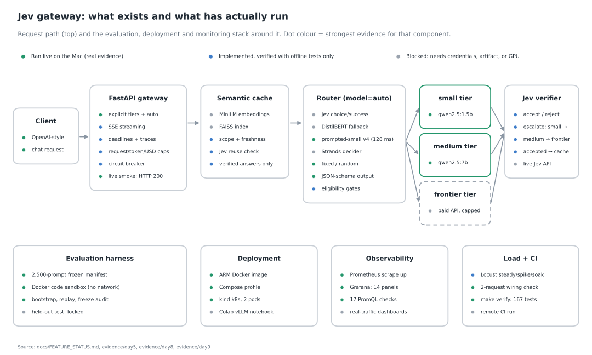
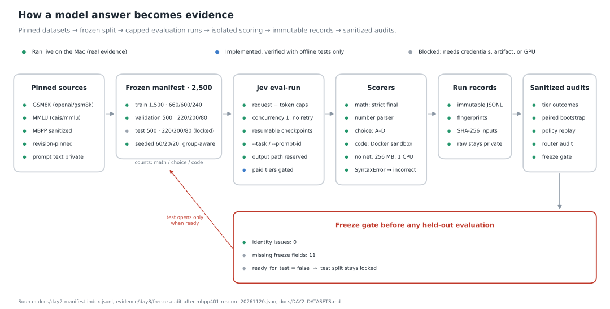
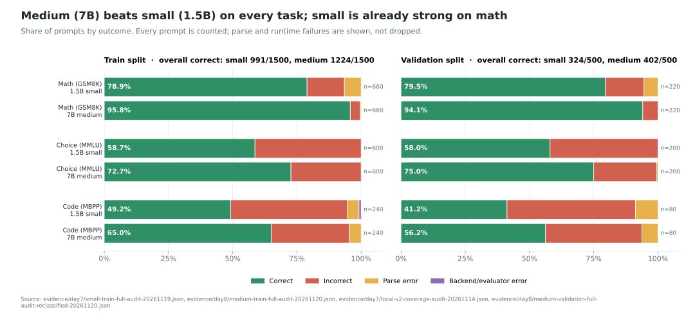
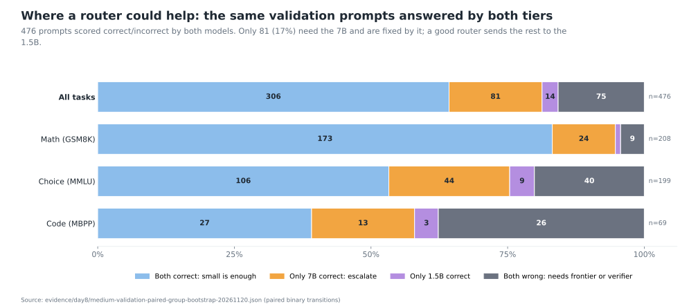
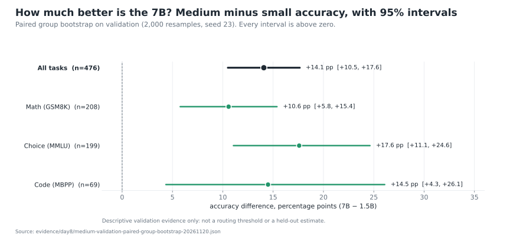
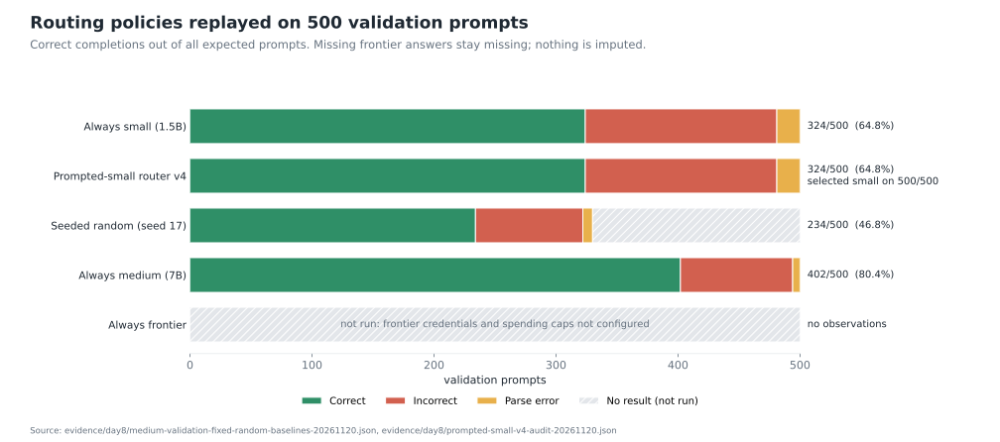
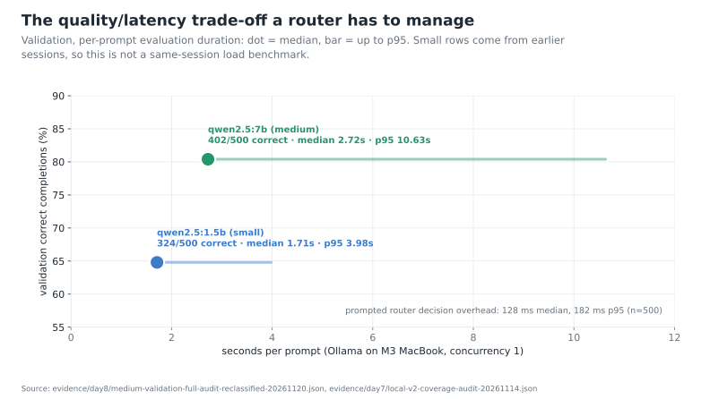
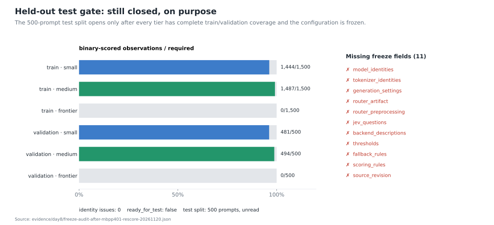
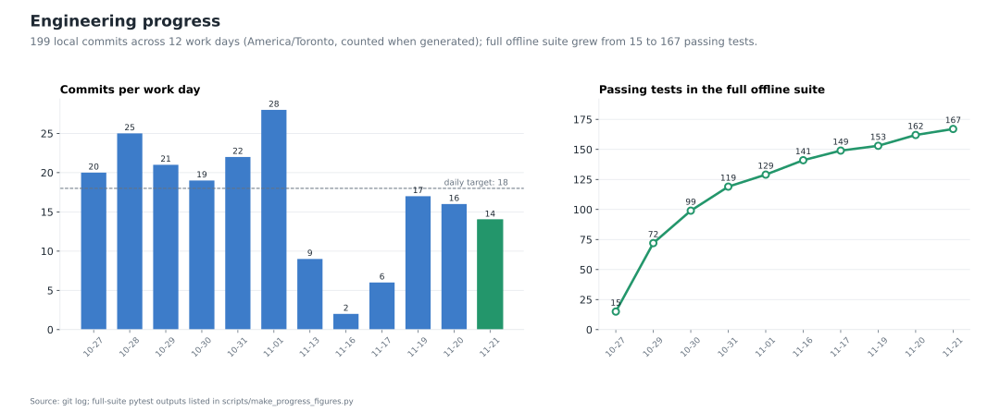

# Progress figures

These nine figures summarize what the repository contains and what has actually been measured. They are generated by [`scripts/make_progress_figures.py`](../scripts/make_progress_figures.py) from committed, sanitized evidence only: no raw prompts, model answers, or ignored `runs/` files are read. Every chart prints its sample counts and source files. Regenerate them after new evidence lands:

```sh
make setup-figures   # once: separate .venv-figures with requirements/figures.txt
make figures         # rewrites docs/figures/progress/*.svg (deterministic output)
```

Colour key for the diagrams: **green** = ran live on the Mac with recorded evidence, **blue** = implemented and verified by offline tests only, **grey** = blocked on credentials, a trained artifact, or GPU access.

## 1. System map



The request path from client to verified answer, plus the evaluation, deployment, observability, and load/CI stack around it. Both local Ollama tiers, the gateway, the prompted-small router, the Docker image, Compose/Prometheus/Grafana, and kind have real runs. Jev routing/verification and the semantic cache are implemented and tested offline only; live Jev, the frontier tier, the trained DistilBERT fallback, MiniLM/FAISS, and Colab vLLM remain blocked.

## 2. Evaluation pipeline



How an answer becomes evidence: revision-pinned GSM8K/MMLU/MBPP sources, a seeded group-aware 60/20/20 manifest (counts read from `docs/day2-manifest-index.jsonl`), capped and resumable `jev eval-run`, task scorers with a no-network Docker sandbox for code, immutable private run records, and sanitized audits. The freeze gate keeps the 500-prompt test split locked.

## 3. Tier outcomes by task



Correct, incorrect, parse-error, and backend/evaluator-error shares for `qwen2.5:1.5b` and `qwen2.5:7b` on every train and validation prompt. The 7B is better on every task; the gap is smallest on math and largest on multiple choice.

## 4. Paired transitions



The 476 validation prompts scored correct/incorrect by both tiers. 306 are solved by both (small is enough), 81 only by the 7B (worth escalating), 14 only by the 1.5B, and 75 by neither. This is the headroom any router is trying to capture.

## 5. Paired bootstrap



Medium-minus-small accuracy with 95% paired group-bootstrap intervals (2,000 resamples, seed 23): +14.1 pp overall. All intervals exclude zero. Descriptive validation evidence, not a selected threshold.

## 6. Policy replay



Fixed, random, and prompted-router policies over all 500 validation prompts. The prompted-small v4 router chose small for all 500, so it exactly matches always-small (324/500). Frontier results do not exist, so they are drawn as missing rather than imputed.

## 7. Latency vs quality



Per-prompt evaluation duration (median, p95) against validation correct completions for each local tier, with the prompted router's measured decision overhead. Small-tier timings come from earlier sessions, so this is descriptive, not a same-session load benchmark.

## 8. Freeze gate



Binary-scored observations against the coverage the freeze audit requires, plus the 11 freeze fields still missing. `ready_for_test=false`; no test prompt has been read.

## 9. Engineering progress



Local commits per America/Toronto work day (counted when the figure was generated, so the latest day can lag by the commit that adds the figure) and the passing-test count of each saved full offline suite run.
